<div align="center">

# 🎬 CineForge

**요구사항 한 번, 선택 한 번. 그다음은 논스톱.**
콘셉트 조합부터 기획안·SSOT·에셋·검수·생성 인계까지 이어 주는 대화형 AI 영상 제작 오케스트레이터 CLI


-0A7AFF)


</div>

---

## 소개

CineForge는 AI 에이전트(Claude Code·Codex 등)와 함께 쓰는 영상 제작 CLI입니다.

1. 만들고 싶은 영상을 자유롭게 적습니다.
2. CineForge가 **9가지 판단 요소**(대본·시나리오·레퍼런스·플롯/콘셉트·주연 캐릭터·목소리·콘텐츠 콘셉트·스토리 전개·연출)를 판정하고, 요청문에 없는 것만 **처음에 한 번** 묻습니다.
3. 선택이 끝나면 콘셉트 평가 → 기획안 → 검수 → 스토리·캐릭터·세계관 SSOT → 스토리보드 → 에셋·프롬프트·사운드 큐 시트 → 검수까지 멈추지 않고 진행합니다.
4. 비용이 드는 생성·편집 단계는 사용자가 권한(`grant`)을 준 뒤에만 [contents-production-skills](https://github.com/DeclanJeon/contents-production-skills)의 담당 스킬로 넘깁니다.

판단(요소 판정·추천·채점)은 OpenRouter의 **Jev 1.14**가, 기획안 문장은 **GPT-6.2 Sol**이 씁니다. 키가 없으면 **호스트 AI**나 오프라인 규칙이 같은 형식으로 대신합니다.

## 파이프라인

```mermaid
flowchart LR
  REQ([요구사항]) --> S00[S00 접수·분석<br/>9개 판단 요소]
  S00 --> S01[S01 콘셉트 선택<br/>처음 한 번]
  S01 --> S02[S02 조합·적합성·평가]
  S02 --> S03[S03 제작 기획안]
  S03 --> G1{G1 기획안 검수}
  G1 --> S04[S04 대본·스토리 SSOT]
  S04 --> S05[S05 캐릭터·세계관 SSOT]
  S05 --> S06[S06 연출·스토리보드·타이밍]
  S06 --> S07[S07 에셋·프롬프트·사운드 큐]
  S07 --> G2{G2 프리프로덕션 검수<br/>연속성·제약·권리}
  G2 --> GRANT[/grant execution<br/>비용 한도/]
  GRANT --> S08[S08 생성 → 스킬 인계]
  S08 --> S09[S09 편집·사운드·합성]
  S09 --> S10[S10 품질 검수]
  S10 --> G3{G3 사용자 최종 검수}
  G3 --> S11[S11 출력·이력]
  S11 -.-> S12[S12 성과 피드백<br/>설계 단계]
```



## 주요 기능

| | 기능 | 내용 |
|---|---|---|
| 🧭 | 한 번에 끝나는 선택 | 요청문에서 감지된 항목은 묻지 않고, `?`=추천, `!`=나머지 맡기기. `--non-interactive`면 남은 필수 항목을 AI 추천으로 채움 |
| 📚 | 콘셉트 라이브러리 | 18개 축, 377개 항목(형식 12대분류, 장르, 연출, 서사 12구조, 감정 등). `cineforge taxonomy`로 조회 |
| 🧪 | 조합·적합성·평가 | 적합성 규칙 16개, 연출 규칙 팩 14개, 6개 기준 점수(hook·feasibility·emotion·originality·coherence·platform_fit)와 대안 비교 |
| 📝 | 제작 기획안 | 7섹션 기획안(`plan.json`/`plan.md`), 씬·컷·타임라인 |
| 🗂️ | SSOT 8종 | 스토리·캐릭터·세계관·씬·카메라·모션·오디오·콘셉트. 해시 기반 버전·잠금·변경 영향 분석(`impact`, `lock`) |
| 🎨 | 에셋 패키지 | 등장인물·의상·소품·배경, 컷별 시작/끝 프레임, 이미지·영상 생성 프롬프트, 사운드 큐 시트 |
| ✅ | 검수 게이트 | G1 기획안, G2 연속성(CQ01–CQ11)·제약·권리(RS01–RS04), G3 사용자 최종 검수 |
| 📊 | 진행 표시 | 진행률·작업률 막대, 단계별 상태·작업 수·검수 결과·담당 스킬 |
| 🤝 | 스킬 인계 | 단계마다 담당 스킬을 지정한 인계 패킷(`handoffs/*.json`), 증거 파일로만 `complete` |

## 빠른 시작

### 설치

```bash
python -m venv .venv && . .venv/bin/activate
pip install -e ".[dev]"
cineforge --version   # cineforge 0.1.0
```

### 대화형

```bash
cineforge new "60초 코미디 숏드라마, 연출은 시네마틱 실사, 서사는 결말 선공개"
```

### 비대화형 + 논스톱

```bash
# 질문 없이 진행하고, 기획안·프리프로덕션 승인을 미리 위임(생성 비용 권한은 별도)
cineforge new "60초 코미디 숏드라마, 연출은 시네마틱 실사, 서사는 결말 선공개" \
  --non-interactive --nonstop --set aspect=9:16

# 생성 단계 앞에서 멈추면, 비용 한도와 함께 실행 권한을 기록하고 이어서 실행
cineforge grant productions/<id> execution --spend-ceiling 20USD
cineforge run productions/<id>

# 스킬이 생성을 마치면 증거 파일과 함께 완료 기록
cineforge complete productions/<id> S08_generation --evidence renders/*.mp4
```

### 그 밖의 명령

| 명령 | 하는 일 |
|---|---|
| `status <프로젝트>` | 진행률·작업률·검수 상태 |
| `accept <프로젝트> plan\|preproduction\|final` | 게이트 승인 |
| `select <프로젝트>` | 콘셉트 선택 다시 하기 |
| `impact <프로젝트> <ssot>` / `lock <프로젝트> <ssot>` | SSOT 변경 영향 분석(`--apply`) / 잠금(`--unlock`으로 해제) |
| `analyze "<요청>"` | 요구사항 분석만(JSON) |
| `providers` | 판단·생성 공급자 체인과 사용 가능 여부 |
| `taxonomy [--axis narrative]` | 콘셉트 라이브러리 보기·내보내기 |

## 진행 표시 예시

아래는 `--provider mock`(네트워크 없음)으로 위 비대화형 예시를 실제로 실행하고 `grant` 후 `run`한 출력입니다(위쪽 줄 일부 생략).

```text
프로젝트 20261120-001809-60초-코미디-숏드라마-연출은-시네마틱-실사 — 현재 단계: S08_generation
진행률 ███████████████░░░░░░░░░  62.6%   (단계 가중치 기준)
작업률 ██████████████████░░░░░░  73.2%   (완료 작업 / 전체 작업)

단계                        상태                 작업  검수    담당 스킬
S00 요구사항 접수·분석            ✅ done            3/3    -     creative-production
S01 콘셉트 선택(대화형)           ✅ done            3/3    -     concept-intake-design
S02 콘셉트 조합·적합성·평가         ✅ done            4/4    PASS  concept-intake-design
S03 제작 기획안                ✅ done            7/7    PASS  developing-video-synopses, orchestrating-video-preproduction
G1  기획안 검수 게이트            ✅ done            2/2    PASS  creative-production
S04 대본·스토리 SSOT           ✅ done            3/3    -     developing-video-synopses, video-production-assets
S05 캐릭터·세계관 SSOT          ✅ done            6/6    -     designing-video-character-sheets, designing-character-personas
S06 연출·스토리보드·타이밍          ✅ done            4/4    -     storyboarding-video, camera-spatial-design, animatic-direction, silent-visual-storytelling
S07 에셋·프롬프트·사운드 큐 시트      ✅ done            5/5    -     video-production-assets, ai-camera-control, creative-production
G2  프리프로덕션 검수(연속성·제약·권리)  ✅ done            4/4    PASS  video-production-assets
S08 이미지·영상·음성 생성          🔌 waiting_exter   0/4    -     higgsfield-generate, creative-production
    └ 호스트 에이전트가 higgsfield-generate, creative-production로 실행 → 완료 후 `cineforge complete`
S09 편집·사운드·합성             · pending         0/4    -     video-production-assets
S10 품질 검수                 · pending         0/4    -     video-production-assets, creative-production
G3  사용자 최종 검수             · pending         0/1    -     creative-production
S11 최종 출력·이력              · pending         0/2    -     recording-production-history
S12 성과 피드백                ⤼ skipped         0/2    -     topic-demand-selection, searching-social-media
    └ 성과 피드백(L6)은 로드맵 6단계 — 현재 설계만

조합된 제작 콘셉트: 60초 코미디 숏드라마 — 시네마틱 실사 연출 · 결말 선공개 서사
  코미디 × 시네마틱 × 결말 선공개형 | 감정: 공감 → 감동
  평가: 76.0점 (go) hook=90 feasibility=50 emotion=90 originality=50 coherence=90 platform_fit=90
  대안: 서사 → 미스터리 회수형 → 76.0점
  대안: 서사 → 카운트다운형 → 80.0점
```

`grant` 전에는 S08이 `⛔ blocked`로 멈추고 "'execution' 권한 필요" 안내가 나옵니다.

## 공급자와 모델

| 역할 | 기본 | 모델 / 경로 | 가격(100만 토큰당) |
|---|---|---|---|
| 판단(요소 판정·추천·채점) | Jev 1.14 via OpenRouter | `typesafe/jev-1.14` · `POST /api/alpha/decisions` | 입력 $0.042 · 출력 무료 |
| 판단(대체) | Jev 1.14 직접 | TypeSafe `POST /v1/systemone` · `jev-1.14.0` | TypeSafe 요금 |
| 기획안 작성(생성) | **GPT-6.2 Sol** via OpenRouter | `openai/gpt-6.2-sol` · `POST /api/v1/chat/completions` | 입력 $2 · 출력 $10 |
| 키가 없을 때 | 호스트 AI / 규칙 / 목 | `agent_io/` 요청·응답 파일, `heuristic`, `mock` | 무료 |

- 실패하면 다음 공급자로 넘어가고 `provider_log.json`에 이유를 남깁니다.
- 모드: `--provider auto`(기본) · `host` · `openrouter` · `mock`.
- 60초 기획안 1편 예상 비용은 약 $0.07, Jev 판단 1회는 약 $0.00002입니다.

## 환경변수

| 변수 | 용도 |
|---|---|
| `OPENROUTER_API_KEY` | Jev 1.14 판단과 기획안 생성. **이 키를 넣는 것이 유료 호출의 opt-in**이며, 없으면 어떤 유료 호출도 하지 않음 |
| `TYPESAFE_API_KEY` | Jev 1.14 판단(TypeSafe 직접 API) |
| `CINEFORGE_GEN_MODEL` | 기획안 생성 모델 slug. 기본값 `openai/gpt-6.2-sol`(ADR-010). 다른 slug로 덮어쓰기, `off`면 생성 끔 |
| `CINEFORGE_AGENT_MODE=1` | auto 모드에서도 호스트 AI에게 판단·생성을 맡김 |
| `CINEFORGE_LIVE=1` | 실호출 테스트(`tests/test_live_openrouter.py`) 켜기 |

키는 환경변수로만 받고 파일·로그·명령 인자에 남기지 않습니다.

### 호스트 AI 모드

`--provider host`이면 CineForge가 `agent_io/requests/*.json`에 질문을 쓰고 멈춥니다. 에이전트가 `agent_io/responses/*.json`에 같은 형식으로 답을 쓰면 `cineforge run`으로 이어집니다.

## 스킬 연동

CineForge는 [contents-production-skills](https://github.com/DeclanJeon/contents-production-skills)(2.61, 브랜치 `feat/orchestration`)와 짝을 이룹니다.

- **`concept-intake-design`**: 9개 판단 요소를 한 번에 묻고, 콘셉트를 조합·검사·평가해 콘셉트 패킷으로 넘기는 새 스킬입니다. 분류 체계와 규칙은 `cineforge taxonomy --export … --with-rules`로 동기화합니다.
- **라우팅 R33**: `creative-production` 2.4의 Step 0 사전 인테이크가 R33으로 이 스킬을 부릅니다.
- **`creative-production/references/skill-map.md`**: 단계별 담당 스킬, 논스톱 규칙, CineForge 인계 계약을 정리한 문서입니다.
- **인계 패킷**: 단계마다 `handoffs/<단계>.json`에 담당 스킬·입력·권한·비용 한도를 담습니다. 실제 이미지·영상 생성과 편집은 스킬이 실행하고(ADR-005), CineForge는 증거 파일로 완료를 기록합니다.

## 안전·비용 원칙

- CineForge는 유료 이미지·영상 생성 API를 직접 부르지 않습니다. 생성은 `grant execution --spend-ceiling`으로 한도를 정한 뒤 스킬이 실행합니다.
- 테스트와 기본 실행은 네트워크를 쓰지 않습니다. 실호출 테스트는 `CINEFORGE_LIVE=1`일 때만 돕니다.
- 레퍼런스·드라마 각색은 구조·리듬·장르 문법만 참고합니다. 원본 영상·음악·대사는 재사용하지 않고, 원작 캐릭터도 복제하지 않습니다.
- AI 생성 콘텐츠는 게시할 때 플랫폼의 AI 표시 기능과 해시태그로 공개합니다. 영상 안에 'Made with AI' 코너 라벨은 넣지 않습니다.
- AI 페르소나(한서윤) 콘텐츠는 AI임을 숨기지 않고, 영상에 대사를 넣지 않습니다.
- 게시·전송·결제·OAuth·푸시 같은 외부 행동은 CineForge 범위 밖이며, 사용자 승인 없이는 하지 않습니다.

## 로드맵

| 단계 | 내용 | 상태 |
|---|---|---|
| 1 | 콘셉트 라이브러리+조합·평가 | ✅ 구현(v0.1.0) |
| 2 | 스토리·캐릭터·세계관+SSOT | ✅ 규칙 기반 구현 |
| 3 | 연출·스토리보드·타이밍 | ✅ 규칙 기반 구현 |
| 4 | 프롬프트·모델 라우팅·생성 | 🟡 프롬프트·큐 시트·인계 구현, 생성은 스킬 담당 |
| 5 | 편집·연속성 검수 | 🟡 연속성 규칙·G2 구현, 편집 실행은 설계 |
| 6 | 성과 분석·자동 개선 | ⏳ 설계 |

자세한 마일스톤은 [docs/14-roadmap.md](docs/14-roadmap.md)에 있습니다.

## 프로젝트 구조

```text
cineforge/
├── cineforge/                 패키지
│   ├── cli.py                 명령(new·select·run·status·accept·grant·complete·impact·lock·providers·analyze·taxonomy)
│   ├── pipeline.py            단계 실행·상태 기계·게이트
│   ├── intake.py              9개 판단 요소 분석
│   ├── selection.py           한 번에 끝나는 콘셉트 선택
│   ├── concept.py             조합·적합성·평가
│   ├── planner.py, render.py  기획안 생성·렌더
│   ├── ssot.py                SSOT 8종 버전·잠금·영향 분석
│   ├── assets.py              에셋·프레임·프롬프트·사운드 큐 시트
│   ├── qa.py, progress.py     검수 규칙, 진행 표시
│   ├── providers/             jev(OpenRouter·TypeSafe), openrouter-gen, host-agent, heuristic, mock, router
│   └── data/                  taxonomy.yaml, rules.yaml, pipeline.yaml, schemas/(19개)
├── templates/                 기획안·캐릭터 바이블·에셋·프롬프트·사운드 큐 시트
├── examples/plans/            《면접관이 제 전 여친입니다》 60초 예시 기획안
├── docs/                      설계 문서 00–19, adr/
└── tests/                     pytest(오프라인 51개 + 실호출 opt-in 2개)
```

제작 결과는 `productions/<id>/` 아래에 `intake.json`, `selection.json`, `concept.json`, `plan.json`/`plan.md`, `ssot/`, `assets/`, `handoffs/`, `reviews/`, `progress.json`, `provider_log.json`으로 쌓입니다.

## 문서

| 문서 | 내용 |
|---|---|
| [00 색인](docs/00-index.md) | 전체 문서 안내 |
| [01 요구사항 명세(SRS)](docs/01-srs.md) | 기능·비기능 요구사항, 인수 기준 |
| [02 아키텍처](docs/02-architecture.md) | 구성 요소와 데이터 흐름 |
| [03 콘셉트 분류 체계](docs/03-concept-taxonomy.md) · [04 콘셉트 엔진](docs/04-concept-engine.md) | 분류 목록, 조합·평가 |
| [05 상태 기계·스킬 라우팅](docs/05-orchestration-state-machine.md) · [07 단계 계약](docs/07-pipeline-contracts.md) | 단계 전이, 입력·출력·권한 |
| [06 SSOT 데이터 모델](docs/06-ssot-data-model.md) | 8종 SSOT, 버전·잠금 |
| [08 CLI UX](docs/08-cli-ux.md) · [09 진행·검수 보고](docs/09-progress-qa-reporting.md) | 명령과 화면 |
| [10 LLM 공급자 라우팅](docs/10-llm-provider-routing.md) | Jev 요청 형식, 폴백 체인, 호스트 프로토콜 |
| [11 템플릿](docs/11-templates.md) · [12 연속성·검수 규칙](docs/12-continuity-qa-rules.md) | 템플릿, 검수 규칙 |
| [13 비용·권리·안전](docs/13-cost-rights-safety.md) | 권한·비용·권리·AI 표기 |
| [14 로드맵](docs/14-roadmap.md) · [15 테스트 계획](docs/15-test-plan.md) | 일정, 테스트 범위 |
| [17 스킬 업그레이드 계획](docs/17-skills-upgrade-plan.md) · [18 레퍼런스 조사](docs/18-reference-study.md) · [19 엔진 카탈로그](docs/19-engine-catalog.md) | 스킬 2.61, 참고 프로젝트, 엔진 16개 |
| [ADR 목록](docs/adr/README.md) | 설계 결정 001–010 |

## 테스트

```bash
python -m pytest -q                       # 오프라인 51개 통과, 실호출 2개 건너뜀
CINEFORGE_LIVE=1 python -m pytest -q tests/test_live_openrouter.py   # 키 필요, 소액 과금
```
