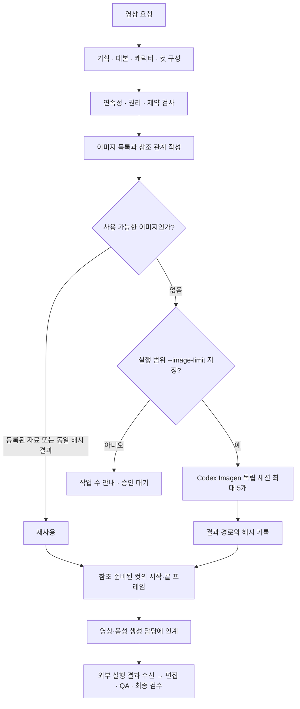

<div align="center">

# 🎬 CineForge

**요구사항 한 번, 선택 한 번. 그다음은 논스톱.**
콘셉트 조합부터 기획안·SSOT·에셋·검수·생성 인계까지 이어 주는 대화형 AI 영상 제작 오케스트레이터 CLI


-0A7AFF)


</div>

---

## 소개

CineForge는 AI 에이전트(Claude Code·Codex 등)와 함께 쓰는 영상 제작 CLI입니다.

1. 만들고 싶은 영상을 자유롭게 적습니다.
2. CineForge가 **9가지 판단 요소**(대본·시나리오·레퍼런스·플롯/콘셉트·주연 캐릭터·목소리·콘텐츠 콘셉트·스토리 전개·연출)를 판정하고, 요청문에 없는 것만 **처음에 한 번** 묻습니다.
3. 선택이 끝나면 콘셉트 평가 → 기획안 → 검수 → 스토리·캐릭터·세계관 SSOT → 스토리보드 → 에셋·프롬프트·사운드 큐 시트 → 검수까지 멈추지 않고 진행합니다.
4. 비용이 드는 생성·편집 단계는 사용자가 권한(`grant`)을 준 뒤에만 [contents-production-skills](https://github.com/DeclanJeon/contents-production-skills)의 담당 스킬로 넘깁니다.

판단(요소 판정·추천·채점)은 OpenRouter의 **Jev 1.14**가, 기획안 문장은 **GPT-6.2 Sol**이 씁니다. 키가 없으면 **호스트 AI**나 오프라인 규칙이 같은 형식으로 대신합니다.

## 파이프라인


## 주요 기능

| | 기능 | 내용 |
|---|---|---|
| 🧭 | 한 번에 끝나는 선택 | 요청문에서 감지된 항목은 묻지 않고, `?`=추천, `!`=나머지 맡기기. `--non-interactive`면 남은 필수 항목을 AI 추천으로 채움 |
| 📚 | 콘셉트 라이브러리 | 18개 축, 377개 항목(형식 12대분류, 장르, 연출, 서사 12구조, 감정 등). `cineforge taxonomy`로 조회 |
| 🧪 | 조합·적합성·평가 | 적합성 규칙 16개, 연출 규칙 팩 14개, 6개 기준 점수(hook·feasibility·emotion·originality·coherence·platform_fit)와 대안 비교 |
| 📝 | 제작 기획안 | 7섹션 기획안(`plan.json`/`plan.md`), 씬·컷·타임라인 |
| 🗂️ | SSOT 8종 | 스토리·캐릭터·세계관·씬·카메라·모션·오디오·콘셉트. 해시 기반 버전·잠금·변경 영향 분석(`impact`, `lock`) |
| 🎨 | 에셋 패키지 | 등장인물·의상·소품·배경, 컷별 시작/끝 프레임, 이미지·영상 생성 프롬프트, 사운드 큐 시트 |
| ✅ | 검수 게이트 | G1 기획안, G2 연속성(CQ01–CQ11)·제약·권리(RS01–RS04), G3 사용자 최종 검수 |
| 📊 | 진행 표시 | 진행률·작업률 막대, 단계별 상태·작업 수·검수 결과·담당 스킬 |
| 🤝 | 스킬 인계 | 단계마다 담당 스킬을 지정한 인계 패킷(`handoffs/*.json`), 증거 파일로만 `complete` |

## 터미널 화면과 에이전트 진행 공유

`cineforge status`는 로고·단계 표·진행률·작업률·다음 행동·멈춤 사유를 보여 줍니다. 색은 TTY에서만 쓰고 `NO_COLOR=1`이나 리다이렉트에서는 같은 정보를 서식 없이 냅니다. `--json`은 화면 장식 없이 `schema_version: 1` 스냅샷만 출력합니다.

`cineforge new`·`run`·`status`는 같은 스냅샷을 `agent_io/progress.json`에 원자적으로 씁니다. 다른 AI 에이전트·감독 프로세스는 이 파일 하나로 현재 단계, 단계별 완료/전체 작업, 검수 상태, 다음 행동, 멈춤 사유를 읽습니다. 별도 상태 원장을 만들지 않으며 `progress.json`이 여전히 정본입니다.

### 사운드 레이어 결정표

사운드 설계는 S04 대본·S06 콘티와 같은 `plan.json`에서 계산되어 `script.md`, `ssot/scene.json`의 컷 `sound`, `ssot/audio.json`, `assets/sound_plan.json`이 같은 값을 공유합니다. 화면마다 다음 우선순위로 한 겹을 고릅니다.

| 순간 | 쓰는 것 | 담당 | 규칙 |
|---|---|---|---|
| 오프닝 훅·엔딩 | **OST(주제가)** | Suno, 보컬 | 씬 하나에 한 번, 최대 12초. 같은 선율을 엔딩에서 회수. 무대사 작품은 같은 곡을 연주 버전으로 |
| 대사 아래 | **BGM 언더스코어** | Suno, 무보컬 | OST와 같은 구간에 겹치지 않음. 대사 구간 -20 dB |
| 장소 전환·호흡 | **공간음(AMBIENCE)** | ElevenLabs | 씬 전체에 깔되 -28 LUFS, 루프 |
| 행동·소품·타격 | **효과음(SFX)** | ElevenLabs | 컷의 `sound`가 동작을 지시할 때만 단발 |
| 인물의 말 | **대사(DIALOGUE)** | Fish Audio(TypeCast 대체) | 무대사 제약이면 생성하지 않음 |
| 의도적 정적 | **무음** | — | 감정 전환·반전 직전. 다른 레이어를 끄고 만든다 |

OST는 "노래 한 곡"이 아니라 **드라마 주제의 회수 장치**입니다. 그래서 `music_themes`에 주제가와 언더스코어를 분리해 두고, 큐에는 `role`·`vocal`을 기록합니다. BGM을 OST로, OST를 BGM으로 바꿔 부르지 않습니다.

## 요청 라우팅·승인·검증

```bash
cineforge route "90초 드라마 만들어줘"        # production / other 판정(JSON)
cineforge route --eval                        # 개발 케이스 정확도(≥0.9 요구)
cineforge route --holdout                     # 별도 12케이스
cineforge authorize <project> --spend-ceiling 20USD --providers suno,elevenlabs --hours 2
cineforge verify <project> --all --attest "전체 파일 확인"
```

- 라우팅은 스킬 설명 유사도에만 기대지 않는다. `/home/declan/.agents/DEVELOPMENT-WORKFLOWS.md`가 제작 요청에서 `cineforge route`를 먼저 실행하도록 고정한다.
- 새 호스트 워크플로우에서는 프로젝트 생성 직후 **제작 실행 계획**을 제안하고, 사용자 채팅 승인 뒤 `authorize --approve-plan HASH`로 기록한다. S08에서 터미널 확인을 반복하지 않는다. 기존 `authorize` 호출은 호환용이며 여전히 대화형이다. 만료되면 실행을 차단한다.
- `verify`는 `--attest`에 사람이 확인한 내용을 적고 **터미널에서 `VERIFY`를 입력**해야 승격된다. 에이전트가 스스로 승격할 수 없다.
- 키·OAuth는 CineForge가 대신 로그인하지 않는다. `cineforge setup`은 상태와 다음 단계만 보여 준다.

### 제작 초반 실행 계획

먼저 영상·음성·음악의 필요 범위와 공급자/모델을 확인하고, 예상 작업 수와 비용을 한 번에 제시한다. 선택된 생성 작업만 `scope.json`에 담는다. 예:

```json
{"lanes":[
  {"kind":"video_cut","provider":"ludyte","model":"singularity-full-v2","max_jobs":4},
  {"kind":"bgm","provider":"suno","model":"v6","max_jobs":1,"unit":"credits","estimate":"10","ceiling":"12"}
]}
```

```bash
cineforge execution-plan <project> --file scope.json
# 위에 출력된 정확한 범위를 사용자에게 제시하고 명시적으로 승인받은 뒤:
cineforge authorize <project> --approve-plan <hash> --hours 24
# 대본·보드·에셋 준비 후:
cineforge execute <project> --stage S08_audio --preview
cineforge execute <project> --stage S08_audio --quotes quotes.json
cineforge execute <project> --stage S08_video
```

견적은 호출자가 실제 공급자에서 확인해 작업 ID별로 `{"unit":"credits","amount":"10","evidence":"견적 출처 또는 ID"}` 형태로 전달한다. CLI는 견적을 직접 가져오지 않는다. 초반에 비용을 알 수 없으면 `estimate: null`을 쓰되 유료 작업마다 상한을 정하고 실제 실행 봉투 작성 전에 견적을 확인한다. 러다이트 영상에는 비용 상한을 지정하지 않는다. 이는 무과금이나 공급자 계정 권한을 보증하지 않는다. Codex Imagen 정지 이미지는 기존 별도 이미지 실행 범위를 따른다.

계획 승인에는 정확한 해시를 사용한다. 공급자·모델·작업 수·상한 범위를 벗어나면 실행 봉투를 내지 않는다. 아직 봉투를 발급하지 않았다면 새 계획을 작성하고 변경분을 승인받는다. 이미 발급한 봉투는 덮어쓰지 않는다. 미확정 요청이나 재작업은 기존 실행 상태·비용을 먼저 대조해야 한다. 이 CLI는 범위를 기록할 뿐 채팅 승인 진위를 독자적으로 검증하지 않으므로, 호출자는 실제 사용자 승인을 받은 경우에만 `--approve-plan`을 호출한다.

## 로컬 모션 그래픽

`ui_state`·`kinetic_type`·`diagram_data`(수치 없는 순차 단계도)·`shape_morph`(사각형·둥근 사각형·원 변형)·`card_sequence`(텍스트 스택·캐러셀·비교)·`echo_type`(구절 스택)·`image_reveal`/`pose_swap`(승인 자산 레이어)·`chart_bars`(출처 필수 막대)·`paper_layers`·`map_route`를 선택한 **무음 9:16 프로젝트**는 컷의 `motion` 데이터를 같은 로컬 렌더러로 실행합니다. UI 선택 및 결과는 30fps 프레임 번호로 기록합니다. 현재 G2에서 검수한 입력과 일치해야 하며, FFmpeg(`drawtext`, `libx264`), ffprobe, 사용할 글리프가 있는 폰트 파일이 필요합니다. 생성 공급자를 호출하지 않습니다.

```bash
cineforge motion "$project" --font /path/to/font.ttf
# qa/motion-preview.mp4를 직접 확인한 뒤, qa/motion-report.json의 정확한 SHA-256 사용
cineforge motion "$project" --deliver <확인한-SHA256>
```

두 번째 명령은 로컬 `final/motion.mp4`와 `motion-delivery.json`을 작성합니다. 기술 검수는 사용자 재생 확인을 대신하지 않고, 로컬 납품은 게시가 아닙니다. 단계도는 `steps` 2~3개와 `reveal_frames`로 순차 공개하며 마지막 뒤 1초 이상 유지합니다. 컷 보조 효과 `motion.entrance`의 `wipe_left`/ `wipe_right`는 완전 공개 시점을 30fps 프레임으로 지정합니다. 주요 상태 변화 전에 끝나야 합니다. 승인 자산은 `assets/motion_assets.json`에 `{path, sha256, rights}`로 등록하며, 불일치·미등록·프로젝트 밖 경로는 렌더하지 않습니다. 차트는 `source`가 없으면 거부합니다. `loop: true`는 실제 첫·마지막 프레임이 같아야 통과합니다. 형태 변환은 30fps 시작·종료 프레임을 지정하고 같은 중심에서 윤곽을 바꾼 뒤 결과 문구를 공개합니다. 오디오·통계 차트·분기형 관계도·임의 SVG 변형·3D 렌더는 지원 범위가 아닙니다.

### 컷 수정 인계 (선택)

새 프로젝트를 시작할 때 수정 범위와 보존 조건이 이미 정해졌다면 두 값을 함께 넘깁니다.

```bash
cineforge new "기존 영상의 발 접지 수정안" --project-id foot-contact-revision --provider host --no-nonstop \
  --cut-revision "C07 / 원본 v2 / 2.10–2.65초" "인물·의상·카메라·입출구 상태"
```

기존 S06~S10 인계가 작성될 때 범위·보존 조건과 컷 수정 QA 가이드가 붙습니다. 외부 단계의 기존 영수증은 이 입력을 함께 고정합니다. 단계별 실행 계획이 기존 S08 인계를 대신하는 경우 새 생성 패킷은 만들지 않습니다. 이 옵션은 컷 ID나 시간 범위를 검증하거나 완료 프로젝트를 다시 열지 않으며, 수정·과금·게시 권한을 부여하지 않습니다. 실제 관찰과 수정 전후 재검수는 기존 QA 양식에 기록하고 전편 재생과 구분합니다.

## 생성 이후 — 검수된 납품까지

S07 이후를 CLI 한 번씩 이어 붙인다. 각 단계는 파일로 남고, 실패는 다음 단계로 넘어가지 않는다.

```bash
cineforge execute <project> --stage S08_audio   # OST/BGM/SFX/대사 job 봉투
cineforge results <project> --stage S08_audio --file results.json
cineforge execute <project> --stage S08_video   # 컷별 영상 job 봉투
cineforge edit <project>                        # 결정적 편집 계획
cineforge render <project>                      # ffmpeg 조립 + 음량 정규화
cineforge verify <project> --all                # 사람 확인 후 verified 승격
cineforge gate <project>                        # verified 게이트
cineforge qa-final <project>                    # 해시·길이·스트림·음량·자막 검수
cineforge deliver <project>                     # final/<project>.mp4 + .srt + delivery.json
```

- 영수증은 입력·출력 SHA-256을 남기고, 불명 작업은 자동 재시도하지 않는다.
- `deliver`는 게이트와 최종 검수를 모두 통과할 때만 파일을 만든다. 하나라도 실패하면 기존 납품을 보존한다.
- `edit/proxy.json`에 `{"width":540,"height":960}`을 두면 프록시 해상도로 렌더한다. 검수는 실제 렌더 크기를 기준으로 한다.
- 실제 provider 호출은 `execution` 승인과 키가 있어야 하며, 이 저장소의 테스트는 로컬 ffmpeg와 가짜 실행기만 쓴다.

## 흡수한 검증 기능 (SceneWeaver)

- `cineforge qa-playback <project> --file report.json`: 납품 파일 해시에 묶인 **사람 재생 검수 기록**. `reviewer_reported`로만 남고 게이트·승인을 바꾸지 않는다.
- `cineforge skills [--root PATH]`: 설치된 팩의 CineForge 계약과 파일 해시를 검사합니다. 납품에는 프로젝트에 고정한 팩 정보를 `delivery.json.skill_pack`에 남기며, 파일 해시를 도구 사용 증거로 간주하지 않습니다.
- 전체 대기·복구·영수증 규칙은 [제작 완결 설계](docs/superpowers/specs/2026-11-20-production-closure-design.md)를 따른다.

## 바로 시작: `cineforge`

인자 없이 `cineforge`를 터미널에서 실행하면 어떤 AI로 진행할지 묻습니다. 이 PC에 설치된 에이전트는 ✓로 표시하고, 지난번 선택(없으면 설치된 첫 에이전트)이 기본값입니다.

- **pi**: 평소 쓰던 pi를 그대로 엽니다. `pi --list-models`로 이미 등록된 프로바이더(구독 로그인·API 키·직접 추가한 것 포함)를 읽어 보여 주고, 모델 범위를 제한하지 않으므로 세션 안에서 `/model`로 전부 쓸 수 있습니다. 등록된 프로바이더가 하나도 없을 때만 어떤 계정으로 로그인할지 묻고 `pi auth login`을 실행합니다.
- **Codex**: `codex login` 확인 후 세션을 엽니다.
- **Claude Code**: `claude auth status`/`claude auth login`으로 확인·로그인한 뒤 세션을 엽니다.
- **agy**(Antigravity CLI): 상태 확인 명령이 없어 바로 `agy -i`로 열고, 로그인이 필요하면 agy가 Google 로그인을 띄웁니다.

어느 쪽이든 제작 규칙이 미리 들어갑니다. 마지막 선택은 `~/.config/cineforge/agent.json`에 기억합니다. 터미널이 아니면(스크립트·파이프) 기존처럼 사용법 오류를 냅니다.

에이전트 안에서 직접 `cineforge new …`를 실행할 때는 `--provider host`가 없어도 됩니다. pi·Claude Code·Codex 환경을 감지해 질문을 에이전트에게 넘깁니다. `CINEFORGE_AGENT_MODE=1`/`0`으로 강제로 켜거나 끌 수 있습니다.

## 제작 서비스 선택과 모든 에이전트 등록

영상·이미지·음성·음악·효과음·아바타를 어떤 서비스로 만들지 **프로젝트 시작 때 한 번** 고릅니다. 목록은 `cineforge/data/providers.yaml`(공식 원격 MCP 중심 75개, 조사: `docs/research/2026-11-24-media-provider-mcp.md`)이며 한 줄로 추가할 수 있습니다.

```bash
cineforge services list                    # 용도별 목록, ✓ = 이미 에이전트에 등록됨
cineforge services list --lane voice --json
cineforge services setup runway            # 미리보기: 어느 에이전트에 무엇이 추가되는지
cineforge services setup runway --yes      # pi·codex·opencode·claude·gemini 중 설치된 곳에 모두 등록
cineforge new "…" --providers video=runway,voice=typecast
```

- **대화형 CLI**: 콘셉트 질문 전에 용도별 번호 선택(Enter=기본값)을 보여 줍니다.
- **에이전트(host) 모드**: S01에서 `agent_io/requests/providers_choice.json`(`kind: user_choice`, `must_ask_user: true`)을 쓰고 `waiting_user`로 멈춥니다. 에이전트는 **대신 답하지 말고** 선택지를 사용자에게 그대로 보여 준 뒤 `{"choices": {용도: id}, "user_said": "사용자가 실제로 한 말"}`을 응답합니다. `user_said`가 없으면 차단됩니다.
- **등록**: 각 에이전트의 공식 CLI(`pi mcp add`, `codex mcp add`, `opencode mcp add --global`, `claude mcp add`)를 쓰고, CLI가 없는 Gemini만 `settings.json`을 백업 후 수정합니다. 같은 이름이나 같은 URL이 이미 있으면 건너뜁니다. API 키 서비스는 키 값이 아니라 환경변수 이름만 등록합니다. OAuth 로그인은 에이전트마다 처음 한 번 브라우저에서 해야 하며, 등록 후 안내가 출력됩니다.
- 선택한 음성 서비스는 대사 TTS 경로(사운드 계획·실행 계획)에 바로 반영됩니다.

## 사운드 디자인과 MCP

S07은 `assets/sound_plan.json`을 씁니다. 큐마다 담당 MCP·도구·프롬프트·루프·AI 표시가 붙습니다: BGM·OST는 **공식 Suno MCP**(`https://api.suno.com/mcp`, OAuth, 도구명은 연결 후 확정), 효과음·공간음은 ElevenLabs(`elevenlabs_sound_effect`), 대사는 Fish Audio(`fish_audio_tts`, TypeCast 대체)입니다. 이 파일은 생성 인계이며 음원 생성 자체는 아직 실행하지 않습니다.

```bash
cineforge setup                                   # 네 서버 준비 상태 확인(다른 에이전트 설치 포함)
cineforge setup --discover                        # Codex/Claude/Gemini/OpenCode MCP 읽기(읽기 전용)
cineforge setup --import-mcp                      # 지금 즉시 기록(자동 동기화와 동일)
cineforge setup --no-sync                         # 자동 갱신 없이 상태만 확인
cineforge mcp-sync start --interval 5             # 백그라운드 감시 시작
cineforge mcp-sync status                         # 실행 여부·마지막 동기화
cineforge mcp-sync stop                           # 중지
cineforge setup --apply suno --recipe "suno=npx -y <suno-mcp-package>" --yes
cineforge setup --set-key elevenlabs              # 숨김 입력
cineforge setup --remove-key suno
```

Suno는 공식 원격 MCP로 **OAuth 로그인**이 필요하다(API 키 없음, Suno 크레딧 사용). Pi에서는 `/mcp login suno`(또는 `pi mcp login suno`)로 승인한다. 다른 키는 호스트 환경변수 또는 `~/.config/cineforge/credentials.json`(0600)에만 저장하고 프로젝트·프롬프트·로그에 남기지 않습니다. 설치는 `--yes`와 서버별 실제 설치 명령(`--recipe`)이 모두 있어야 실행하며, 명령을 모르면 추측해서 만들지 않고 거부합니다. 다른 에이전트에 이미 설치된 MCP는 `--discover`/`--import-mcp`로 읽어 재사용하며, 외부 설정을 수정하거나 비밀 값을 복사하지 않고 환경변수 이름만 기록합니다. `setup`은 실행할 때마다 **자동 동기화**합니다 — 새 MCP 추가, 명령·URL 변경 갱신, 사라진 항목 제거, 충돌은 선택/대안으로 기록. 백그라운드 감시가 필요하면 `cineforge mcp-sync start`를 쓴다. 감시자는 외부 설정을 읽기만 하고 `~/.config/cineforge` 아래 캐시·상태·로그만 쓴다(비밀 값 복사 없음, PID 잠금, SIGTERM 종료). MCP 도구가 Pi/Codex 세션에 실제로 노출되는지는 호스트 설정이 결정합니다.

## 이미지 자동 제작 (Linux)

새 프로젝트는 기본 논스톱입니다. 수동 검토는 `--no-nonstop`. 기획을 먼저 실행한 뒤 `cineforge run <project> --image-limit N`으로 작품 누적 이미지 호출 수와 참조 전송을 승인하거나, 처음부터 `new`에 같은 옵션을 줍니다. N은 동시 실행 수가 아닙니다(동시 실행 최대 5). 스킬 정책상 Codex Imagen 정지 이미지는 유료 견적·비용 상한 대상이 아니므로, 이 값은 실행 범위와 참조 전송 범위를 제한하는 장치입니다. 비용·원격 작업이 불확실하면 자동 재제출하지 않습니다.



제공 이미지는 프로젝트 아래에 두고 `assets/supplied_images.json`에 `{"프롬프트ID":"상대경로"}`로 명시합니다. 큐는 감독 CLI가 떠 있는 동안 독립 프로세스 세션으로 실행되며 GUI 창이나 상시 데몬이 아닙니다. 산출물 목록은 `assets/image_outputs.json`, 작업별 기록은 `assets/image_jobs/`입니다. 영상·음성·편집은 기존 외부 인계이며 이 큐가 대신 실행하지 않습니다.

## 빠른 시작

### 설치

```bash
python -m venv .venv && . .venv/bin/activate
pip install -e ".[dev]"
cineforge --version   # cineforge 0.1.7
```

코드 모션 컷의 승인·접수·조립·재생 검수는 [코드 모션 납품 절차](docs/code-motion.md)를 따릅니다.

### 대화형

`--project-id`를 생략하면 터미널에서 폴더용 프로젝트명을 묻습니다. 영문 소문자·숫자 단어를 하이픈으로 연결하세요(예: `comedy-short`). 작품 제목이나 요청문은 바뀌지 않습니다.

```bash
cineforge new "60초 코미디 숏드라마, 연출은 시네마틱 실사, 서사는 결말 선공개"
```

### 비대화형 + 논스톱

```bash
# 질문 없이 진행하고, 기획안·프리프로덕션 승인을 미리 위임(생성 비용 권한은 별도)
cineforge new "60초 코미디 숏드라마, 연출은 시네마틱 실사, 서사는 결말 선공개" \
  --project-id comedy-short --non-interactive --nonstop --set aspect=9:16

# 생성 단계 앞에서 멈추면, 비용 한도와 함께 실행 권한을 기록하고 이어서 실행
cineforge grant productions/<id> execution --spend-ceiling 20USD
cineforge run productions/<id>

# 스킬이 생성을 마치면 증거 파일과 함께 완료 기록
cineforge complete productions/<id> S08_generation --evidence renders/*.mp4
```

### 그 밖의 명령

| 명령 | 하는 일 |
|---|---|
| `status <프로젝트>` | 진행률·작업률·검수 상태 |
| `accept <프로젝트> plan\|preproduction\|final` | 게이트 승인 |
| `select <프로젝트>` | 콘셉트 선택 다시 하기 |
| `impact <프로젝트> <ssot>` / `lock <프로젝트> <ssot>` | SSOT 변경 영향 분석(`--apply`) / 잠금(`--unlock`으로 해제) |
| `analyze "<요청>"` | 요구사항 분석만(JSON) |
| `providers` | 판단·생성 공급자 체인과 사용 가능 여부 |
| `taxonomy [--axis narrative]` | 콘셉트 라이브러리 보기·내보내기 |

## 진행 표시 예시

아래는 `--provider mock`(네트워크 없음)으로 위 비대화형 예시를 실제로 실행하고 `grant` 후 `run`한 출력입니다(위쪽 줄 일부 생략).

```text
프로젝트 20261120-001809-60초-코미디-숏드라마-연출은-시네마틱-실사 — 현재 단계: S08_generation
진행률 ███████████████░░░░░░░░░  62.6%   (단계 가중치 기준)
작업률 ██████████████████░░░░░░  73.2%   (완료 작업 / 전체 작업)

단계                        상태                 작업  검수    담당 스킬
S00 요구사항 접수·분석            ✅ done            3/3    -     creative-production
S01 콘셉트 선택(대화형)           ✅ done            3/3    -     concept-intake-design
S02 콘셉트 조합·적합성·평가         ✅ done            4/4    PASS  concept-intake-design
S03 제작 기획안                ✅ done            7/7    PASS  developing-video-synopses, orchestrating-video-preproduction
G1  기획안 검수 게이트            ✅ done            2/2    PASS  creative-production
S04 대본·스토리 SSOT           ✅ done            3/3    -     developing-video-synopses, video-production-assets
S05 캐릭터·세계관 SSOT          ✅ done            6/6    -     designing-video-character-sheets, designing-character-personas
S06 연출·스토리보드·타이밍          ✅ done            4/4    -     storyboarding-video, camera-spatial-design, animatic-direction, silent-visual-storytelling
S07 에셋·프롬프트·사운드 큐 시트      ✅ done            5/5    -     video-production-assets, ai-camera-control, creative-production
G2  프리프로덕션 검수(연속성·제약·권리)  ✅ done            4/4    PASS  video-production-assets
S08 이미지·영상·음성 생성          🔌 waiting_exter   0/4    -     higgsfield-generate, creative-production
    └ 호스트 에이전트가 higgsfield-generate, creative-production로 실행 → 완료 후 `cineforge complete`
S09 편집·사운드·합성             · pending         0/4    -     video-production-assets
S10 품질 검수                 · pending         0/4    -     video-production-assets, creative-production
G3  사용자 최종 검수             · pending         0/1    -     creative-production
S11 최종 출력·이력              · pending         0/2    -     recording-production-history
S12 성과 피드백                ⤼ skipped         0/2    -     topic-demand-selection, searching-social-media
    └ 성과 피드백(L6)은 로드맵 6단계 — 현재 설계만

조합된 제작 콘셉트: 60초 코미디 숏드라마 — 시네마틱 실사 연출 · 결말 선공개 서사
  코미디 × 시네마틱 × 결말 선공개형 | 감정: 공감 → 감동
  평가: 76.0점 (go) hook=90 feasibility=50 emotion=90 originality=50 coherence=90 platform_fit=90
  대안: 서사 → 미스터리 회수형 → 76.0점
  대안: 서사 → 카운트다운형 → 80.0점
```

`grant` 전에는 S08이 `⛔ blocked`로 멈추고 "'execution' 권한 필요" 안내가 나옵니다.

## 공급자와 모델

| 역할 | 기본 | 모델 / 경로 | 가격(100만 토큰당) |
|---|---|---|---|
| 판단(요소 판정·추천·채점) | Jev 1.14 via OpenRouter | `typesafe/jev-1.14` · `POST /api/alpha/decisions` | 입력 $0.042 · 출력 무료 |
| 판단(대체) | Jev 1.14 직접 | TypeSafe `POST /v1/systemone` · `jev-1.14.0` | TypeSafe 요금 |
| 기획안 작성(생성) | **GPT-6.2 Sol** via OpenRouter | `openai/gpt-6.2-sol` · `POST /api/v1/chat/completions` | 입력 $2 · 출력 $10 |
| 키가 없을 때 | 호스트 AI / 규칙 / 목 | `agent_io/` 요청·응답 파일, `heuristic`, `mock` | 무료 |

- 실패하면 다음 공급자로 넘어가고 `provider_log.json`에 이유를 남깁니다.
- 모드: `--provider auto`(기본) · `host` · `openrouter` · `mock`.
- 60초 기획안 1편 예상 비용은 약 $0.07, Jev 판단 1회는 약 $0.00002입니다.

## 환경변수

| 변수 | 용도 |
|---|---|
| `OPENROUTER_API_KEY` | Jev 1.14 판단과 기획안 생성. **이 키를 넣는 것이 유료 호출의 opt-in**이며, 없으면 어떤 유료 호출도 하지 않음 |
| `TYPESAFE_API_KEY` | Jev 1.14 판단(TypeSafe 직접 API) |
| `CINEFORGE_GEN_MODEL` | 기획안 생성 모델 slug. 기본값 `openai/gpt-6.2-sol`(ADR-010). 다른 slug로 덮어쓰기, `off`면 생성 끔 |
| `CINEFORGE_AGENT_MODE=1` | auto 모드에서도 호스트 AI에게 판단·생성을 맡김 |
| `CINEFORGE_LIVE=1` | 실호출 테스트(`tests/test_live_openrouter.py`) 켜기 |

키는 환경변수로만 받고 파일·로그·명령 인자에 남기지 않습니다.

### 로컬 검증·복구 (SceneWeaver 이식)

- 외부 작업 대기 상태에서만 최초 완료를 기록합니다. `--evidence`에는 프로젝트 내부 실제 파일을 지정하세요. 목록 파일을 지정하면 목록 자체만 검증하므로 원본 테이크/편집본도 각각 명시해야 합니다.
- 완료 시 입력·출력 SHA-256을 `receipts/<단계>.json`에 먼저 저장합니다. 상태 기록 전 중단됐다면 `cineforge run`으로 복구합니다. 해시 불일치 또는 기존 완료 단계에 영수증이 없으면 자동 인정하지 않습니다. 영수증은 시청 판정이나 원격 작업 접수증이 아닙니다.
- 출연진은 프로젝트마다 지정합니다. `--with-dialogue`와 `--no-speech`는 인물 이름과 무관한 작품별 옵션입니다.
- Pi 서명 모드는 선택 사항입니다. 실행기와 Pi 서명 프로세스에만 프로젝트 밖의 32바이트 이상 비밀 파일 경로 `CINEFORGE_HOST_KEY_FILE`을 지정하세요. `--provider host`로 요청한 뒤 같은 환경에서 `python -m cineforge.host_sign REQUEST.json BODY.json`으로 응답을 작성하고 `cineforge run`으로 이어갑니다. 비밀 파일을 저장소나 프롬프트에 넣지 마세요. 기존 무서명 모드는 호환용이며 서명된 요청에 대체 사용할 수 없습니다. 제안은 실행 권한이 아닙니다.

### 호스트 AI 모드

`--provider host`이면 CineForge가 `agent_io/requests/*.json`에 질문을 쓰고 멈춥니다. 에이전트가 `agent_io/responses/*.json`에 같은 형식으로 답을 쓰면 `cineforge run`으로 이어집니다.

## 스킬 연동

새 제작에는 CineForge 계약 v1을 선언하는 [contents-production-skills](https://github.com/DeclanJeon/contents-production-skills) 설치가 필요합니다.

**릴리스로 설치·업데이트(권장).** 업데이트는 사용자가 직접 실행할 때만 일어납니다.

```bash
cineforge skills update --check     # 최신 릴리스와 변경 내용 확인(아무것도 쓰지 않음)
cineforge skills update --yes       # 내려받기 → SHA-256 검증 → 버전별 폴더 설치 → 새 프로젝트의 기본 팩으로 지정
cineforge skills list               # 설치된 버전과 활성 버전
cineforge skills use 2.64           # 이미 설치한 다른 버전으로 전환
```

- 설치 위치: `${XDG_DATA_HOME:-~/.local/share}/cineforge/skill-packs/contents-production-skills-<버전>/`. 이전 버전 폴더는 지우지 않습니다.
- 활성 버전: `${XDG_CONFIG_HOME:-~/.config}/cineforge/skill-pack.json`. 탐색 순서는 `CINEFORGE_SKILL_PACK` → 활성 버전 → 기본 스킬 루트입니다.
- 진행 중인 프로젝트는 잠금된 팩 버전을 계속 씁니다. 활성 버전이 바뀌어도 저장된 버전 폴더에서 같은 팩을 찾습니다.
- 버전별 변경 내용은 [CineForge 개발노트](https://cineforge-7ps.pages.dev/changelog/)에 있습니다.

**저장소에서 직접 장착.** 팩 원본 또는 팩 설치기로 복사한 스킬 루트를 장착합니다.

```bash
# 팩 저장소에서: 필요하면 임시 또는 버전별 루트에 복사 설치
python scripts/install_package.py --skills-root "$HOME/skill-packs/production-v1"
export CINEFORGE_SKILL_PACK="$HOME/skill-packs/production-v1"
cineforge skills
```

- 지원되는 기본 스킬 루트에 설치하면 자동으로 찾습니다. 서로 다른 팩이 여러 개거나 스킬별 심볼릭 링크로 설치했다면 `CINEFORGE_SKILL_PACK`에 사용할 팩의 실제 루트를 지정하세요.
- 제작 단계의 담당 스킬·라우트·참조는 설치된 팩이 정합니다. 호환 팩을 바꾸면 새 프로젝트부터 적용되고 CLI 재설치는 필요하지 않습니다.
- 기존 프로젝트는 `skill_pack.lock.json`의 팩 버전과 해시를 유지합니다. 팩이 없어도 `status`는 보이지만 제작 재개에는 잠금과 같은 팩을 복원해 장착해야 합니다. 잠금 도입 이전 프로젝트는 `legacy/unpinned`로 계속 동작합니다.
- 팩 없는 `--provider mock`은 오프라인 구조 확인용입니다. 미바인딩 프로젝트에서는 외부 작업과 납품을 실행할 수 없습니다. 설치·진단만으로 팩 코드를 실행하거나 권한을 부여하지 않습니다.

## 안전·비용 원칙

- CineForge는 유료 이미지·영상 생성 API를 직접 부르지 않습니다. 생성은 `grant execution --spend-ceiling`으로 한도를 정한 뒤 스킬이 실행합니다.
- 테스트와 기본 실행은 네트워크를 쓰지 않습니다. 실호출 테스트는 `CINEFORGE_LIVE=1`일 때만 돕니다.
- 레퍼런스·드라마 각색은 구조·리듬·장르 문법만 참고합니다. 원본 영상·음악·대사는 재사용하지 않고, 원작 캐릭터도 복제하지 않습니다.
- AI 생성 콘텐츠는 게시할 때 플랫폼의 AI 표시 기능과 해시태그로 공개합니다. 영상 안에 'Made with AI' 코너 라벨은 넣지 않습니다.
- AI 페르소나 콘텐츠는 AI임을 숨기지 않습니다. 이 표시 규칙은 대사 유무와 별개입니다.
- 게시·전송·결제·OAuth·푸시 같은 외부 행동은 CineForge 범위 밖이며, 사용자 승인 없이는 하지 않습니다.

## 로드맵

| 단계 | 내용 | 상태 |
|---|---|---|
| 1 | 콘셉트 라이브러리+조합·평가 | ✅ 구현(v0.1.0) |
| 2 | 스토리·캐릭터·세계관+SSOT | ✅ 규칙 기반 구현 |
| 3 | 연출·스토리보드·타이밍 | ✅ 규칙 기반 구현 |
| 4 | 프롬프트·모델 라우팅·생성 | 🟡 프롬프트·큐 시트·인계 구현, 생성은 스킬 담당 |
| 5 | 편집·연속성 검수 | 🟡 연속성 규칙·G2 구현, 편집 실행은 설계 |
| 6 | 성과 분석·자동 개선 | ⏳ 설계 |

자세한 마일스톤은 [docs/14-roadmap.md](docs/14-roadmap.md)에 있습니다.

## 프로젝트 구조

```text
cineforge/
├── cineforge/                 패키지
│   ├── cli.py                 명령(new·select·run·status·accept·grant·complete·impact·lock·providers·analyze·taxonomy)
│   ├── pipeline.py            단계 실행·상태 기계·게이트
│   ├── intake.py              9개 판단 요소 분석
│   ├── selection.py           한 번에 끝나는 콘셉트 선택
│   ├── concept.py             조합·적합성·평가
│   ├── planner.py, render.py  기획안 생성·렌더
│   ├── ssot.py                SSOT 8종 버전·잠금·영향 분석
│   ├── assets.py              에셋·프레임·프롬프트·사운드 큐 시트
│   ├── qa.py, progress.py     검수 규칙, 진행 표시
│   ├── providers/             jev(OpenRouter·TypeSafe), openrouter-gen, host-agent, heuristic, mock, router
│   └── data/                  taxonomy.yaml, rules.yaml, pipeline.yaml, schemas/(19개)
├── templates/                 기획안·캐릭터 바이블·에셋·프롬프트·사운드 큐 시트
├── examples/plans/            《면접관이 제 전 여친입니다》 60초 예시 기획안
├── docs/                      설계 문서 00–19, adr/
└── tests/                     pytest(오프라인 51개 + 실호출 opt-in 2개)
```

제작 결과는 `productions/<id>/` 아래에 `intake.json`, `selection.json`, `concept.json`, `plan.json`/`plan.md`, `ssot/`, `assets/`, `handoffs/`, `reviews/`, `progress.json`, `provider_log.json`으로 쌓입니다.

## 문서

| 문서 | 내용 |
|---|---|
| [00 색인](docs/00-index.md) | 전체 문서 안내 |
| [01 요구사항 명세(SRS)](docs/01-srs.md) | 기능·비기능 요구사항, 인수 기준 |
| [02 아키텍처](docs/02-architecture.md) | 구성 요소와 데이터 흐름 |
| [03 콘셉트 분류 체계](docs/03-concept-taxonomy.md) · [04 콘셉트 엔진](docs/04-concept-engine.md) | 분류 목록, 조합·평가 |
| [05 상태 기계·스킬 라우팅](docs/05-orchestration-state-machine.md) · [07 단계 계약](docs/07-pipeline-contracts.md) | 단계 전이, 입력·출력·권한 |
| [06 SSOT 데이터 모델](docs/06-ssot-data-model.md) | 8종 SSOT, 버전·잠금 |
| [08 CLI UX](docs/08-cli-ux.md) · [09 진행·검수 보고](docs/09-progress-qa-reporting.md) | 명령과 화면 |
| [10 LLM 공급자 라우팅](docs/10-llm-provider-routing.md) | Jev 요청 형식, 폴백 체인, 호스트 프로토콜 |
| [11 템플릿](docs/11-templates.md) · [12 연속성·검수 규칙](docs/12-continuity-qa-rules.md) | 템플릿, 검수 규칙 |
| [13 비용·권리·안전](docs/13-cost-rights-safety.md) | 권한·비용·권리·AI 표기 |
| [14 로드맵](docs/14-roadmap.md) · [15 테스트 계획](docs/15-test-plan.md) | 일정, 테스트 범위 |
| [17 스킬 업그레이드 계획](docs/17-skills-upgrade-plan.md) · [18 레퍼런스 조사](docs/18-reference-study.md) · [19 엔진 카탈로그](docs/19-engine-catalog.md) | 스킬 2.61, 참고 프로젝트, 엔진 16개 |
| [ADR 목록](docs/adr/README.md) | 설계 결정 001–010 |

## 테스트

```bash
python -m pytest -q                       # 오프라인 51개 통과, 실호출 2개 건너뜀
CINEFORGE_LIVE=1 python -m pytest -q tests/test_live_openrouter.py   # 키 필요, 소액 과금
```

## 라이선스

[MIT](LICENSE) © 2026 Declan Jeon

## 목표 기반 실행 (`--goal`, 선택 기능)

요청의 **완료 조건**을 `goal.json`에 저장하고, 그 범위 안에서만 진행·종료합니다. `--goal`을 쓰지 않은 프로젝트는 종전과 같습니다.

```bash
cineforge new "15초 9:16 광고 스토리보드만" --project-id demo --goal auto   # 보드 검증 후 종료, 생성 호출 0회
cineforge new "15초 9:16 광고 최종 MP4 납품" --project-id demo2 --goal auto
cineforge goal show demo2            # 목표와 증거 평가(읽기 전용)
cineforge goal drive demo2 --json    # 허용 범위 안에서 다음 행동을 수행하고 상태 반환
```

| 상태 | 종료 코드 | 의미 |
|---|---|---|
| `satisfied` | 0 | 완료 증거 충족 |
| `needs_user` / `waiting_external` / `busy` | 3 | 사용자 승인·검수 또는 호스트 작업·다른 실행 대기 |
| `blocked` / `needs_reconciliation` | 4 | 수정 불가 또는 원격 접수 여부 불명(`goal reconcile`로 대조, 자동 재전송 없음) |

- 텍스트 보드 목표: 컷 고유성·카메라 연결·길이(±1프레임@24fps)·화면비를 검사. 이후 단계(`run`, `execute`, `render`, `deliver` 등)는 거부됩니다. 총길이만 어긋나면 컷 길이를 프레임 단위로 비례 재배분합니다(잠금 시 중단).
- MP4 목표: 렌더·기술 QA·gate·**해당 렌더 해시에 대한 사용자 승인**(`accept final`이 해시를 기록)·납품본 해시 일치까지 확인. 검증(`verify`)과 최종 승인은 항상 사람이 합니다.
- `run --until`은 운영자 중단점이며 목표 달성 증거가 아닙니다.

## 대사 기본값: 영상 모델 네이티브

캐릭터 대사는 기본적으로 **같은 영상 요청의 AUDIO 섹션**에 넣어 영상 모델이 음성과 함께 생성합니다(화자·대사·고정 음성 정체성). 이때 별도 TTS(`dialogue`) 작업은 만들지 않으며, 모델의 네이티브 오디오 지원 여부는 `native_audio_support: UNVERIFIED`로 기록합니다(실행 직전 확인). 별도 음성은 `cineforge new ... --external-voice`로 명시했을 때만 계획됩니다. 무대사(`--no-speech`)는 그대로 무음입니다.
