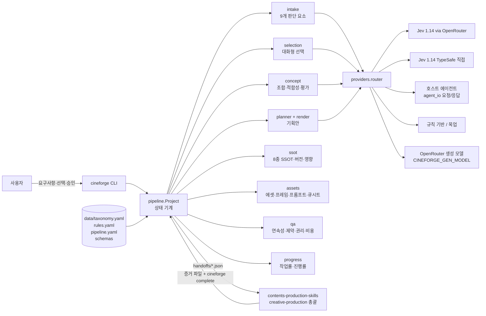
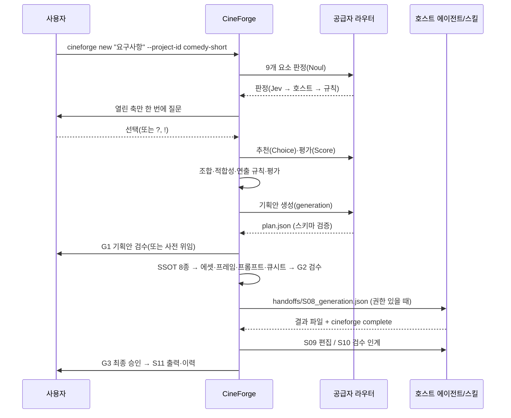

# 02. 아키텍처

## 1. 구성 요소



## 2. 실행 흐름



## 3. 폴더 구조(프로젝트)

```
productions/<project_id>/
  project.json        요청·공급자 모드·버전
  authority.json      사용자가 준 승인·권한만
  progress.json       단계 상태·작업·검수·진행률
  history.jsonl       모든 이벤트(시간순)
  intake.json  selection.json  concept.json  plan.json  plan.md  script.md
  ssot/{concept,story,character,world,scene,camera,motion,audio}.json
  assets/{asset_registry,frames,image_prompts,video_prompts,sound_cue_sheet}.json
  reviews/{plan_review,preproduction_review,final_qa,user_review}.json
  handoffs/<stage>.json
  agent_io/requests|responses/<task>.json
  provider_log.json   공급자 선택·폴백 기록(키 없음)
```

## 4. 설계 원칙

1. **선택은 앞에서 한 번** — 이후 단계는 선택·콘셉트를 상속하고 질문하지 않는다. 승인 게이트만 남는다.
2. **판단과 생성의 분리** — Jev는 typed 판단 전용, 문장은 호스트 AI/생성 모델(ADR-003).
3. **실행은 스킬에게** — CineForge는 유료 API를 직접 부르지 않고 인계 패킷과 증거 기반 완료만 관리(ADR-005).
4. **데이터 주도** — 분류·규칙·파이프라인은 YAML, 산출물은 JSON 스키마.
5. **오프라인 기본** — 키가 없으면 규칙 기반·목업으로 끝까지 시험 가능.
