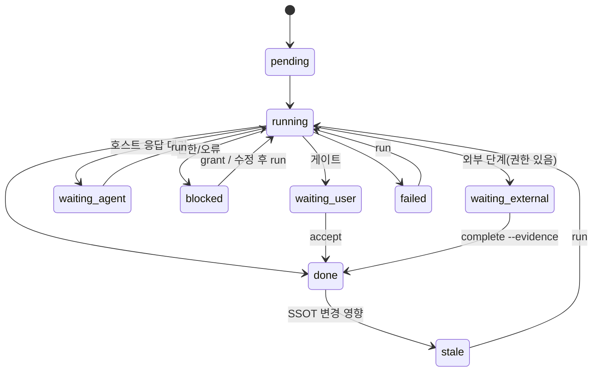
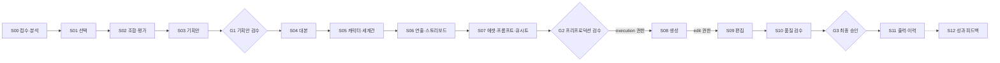

# 05. 오케스트레이션 상태 기계와 스킬 라우팅

## 1. 단계 상태

| 상태 | 의미 | 다음 |
|---|---|---|
| pending | 아직 시작 안 함 | running |
| running | 실행 중 | done / blocked / waiting_* / failed |
| waiting_user | 사용자 승인 필요(G1·G2·G3) | `accept` → done |
| waiting_agent | 호스트 AI 응답 필요 | 응답 파일 후 `run` |
| blocked | 권한·검수 오류·적합성 오류로 진행 불가 | 원인 해결 후 `run` |
| waiting_external | 스킬이 외부 작업 중(S08–S11) | `complete --evidence` → done |
| stale | 상위 SSOT 변경으로 다시 만들어야 함 | `run` |
| failed | 스키마 오류·공급자 오류 | 수정 후 `run` |
| skipped | 이번 실행 범위 밖(S12) | — |
| done | 완료 | — |

## 2. 파이프라인

실행 루프(`Project.run`)는 순서대로 단계를 돌리며 `done`/`skipped`는 건너뛴다. 한 단계가 `done`이 아니면 멈추고 그 이유를 노트로 남긴다. `--until`로 특정 단계에서 멈출 수 있다.

## 3. 권한 모델

`authority.json`은 사용자가 CLI로 준 것만 기록한다.

| 키 | 주는 방법 | 여는 것 |
|---|---|---|
| accept_plan | `accept 
 plan`, `--auto-accept-plan`, `--nonstop` | G1 통과 |
| accept_preproduction | `accept 
 preproduction`, `--nonstop` | G2 통과 |
| execution (+spend_ceiling) | `grant 
 execution --spend-ceiling 20USD` | S08 인계 |
| edit | `grant 
 edit` | S09 인계 |
| publish | `grant 
 publish` | 게시(인계만, MVP 범위 밖) |

`--nonstop`은 검수 게이트만 미리 위임하며 실행·비용은 열지 않는다(스킬 패키지 policy.md §1과 같은 원칙).

## 4. 스킬 라우팅 지도

| 단계 | route | 담당 스킬 | CineForge가 하는 일 | 스킬이 하는 일 |
|---|---|---|---|---|
| S00 | — | creative-production | 요청 분석, 9개 요소 판정 | 총괄 범위 확인 |
| S01–S02 | R33 | concept-intake-design (신규) | 선택 UI, 조합·적합성·평가 | 동일 절차를 대화로 수행(CLI 없을 때) |
| S03 | R05 / R02 | orchestrating-video-preproduction / developing-video-synopses | 기획안 요청 패킷, 스키마 검증, 사전 점검, 렌더 | 기획안 문장 작성(호스트 AI) |
| S04 | R13 | video-production-assets, developing-video-synopses | story SSOT, script.md 초안 | 대본 다듬기 |
| S05 | R03 / R04 | designing-video-character-sheets / designing-character-personas | character·world SSOT, 정체성 앵커 | 캐릭터 바이블·페르소나 심화 |
| S06 | R10, R18, R08, R07 | storyboarding-video, camera-spatial-design, animatic-direction, silent-visual-storytelling | scene·camera·motion SSOT | 콘티·카메라·타이밍 다듬기 |
| S07 | R13, R19 | video-production-assets, ai-camera-control | 에셋 목록, 시작/끝 프레임, 프롬프트, 큐 시트 | 모델별 프롬프트 방언 변환 |
| G2 | — | video-production-assets(연속성 게이트) | CQ·RS 규칙, 비용 티어 | 전체 스토리라인 연속성 게이트 |
| S08 | R28 / R32 | higgsfield-generate / fal 경로 | 인계 패킷, 권한 확인 | 실제 생성(사용자 승인·비용 한도 안) |
| S09 | R31 | video-production-assets | 인계 패킷 | 로컬 편집·출력 |
| S10 | R20 | video-production-assets | 인계 패킷 | 실제 결과물 검수 |
| S11 | R27 | recording-production-history | 인계 패킷 | final/ 저장·이력 |
| S12 | — | topic-demand-selection, searching-social-media | (설계만) | 성과·수요 근거 |

### 공백(gap)과 조치

| 공백 | 영향 | 조치 |
|---|---|---|
| 업프런트 인테이크 전담 스킬 없음 | 단계마다 다시 묻거나 총괄이 즉흥 판단 | **concept-intake-design + R33 신설(2.61)** |
| 전체 단계 지도 없음 | 총괄이 다음 담당을 매번 추론 | **creative-production/references/skill-map.md 신설** |
| 사운드 큐 시트 전담 route 없음 | R13(에셋 하나)로 처리 | 유지(R13 범위 안). 별도 route는 필요 시 |
| 성과 피드백 루프 | S12 비어 있음 | 로드맵 6단계 |
| 자동 품질 평가(영상) | S10은 인계만 | 로드맵 4단계 |

## 목표 기반 실행(선택)

`goal.json` 이 있는 프로젝트만 해당. 단계 상태가 아니라 증거로 완료를 판정하며 `Project.run`은 목표의 단계 상한(`text_storyboard`=S06)을 넘지 않는다. 상태·종료 코드·복구 절차는 README의 「목표 기반 실행」, 설계는 `docs/superpowers/specs/2026-11-24-goal-driver-design.md` 참조.
